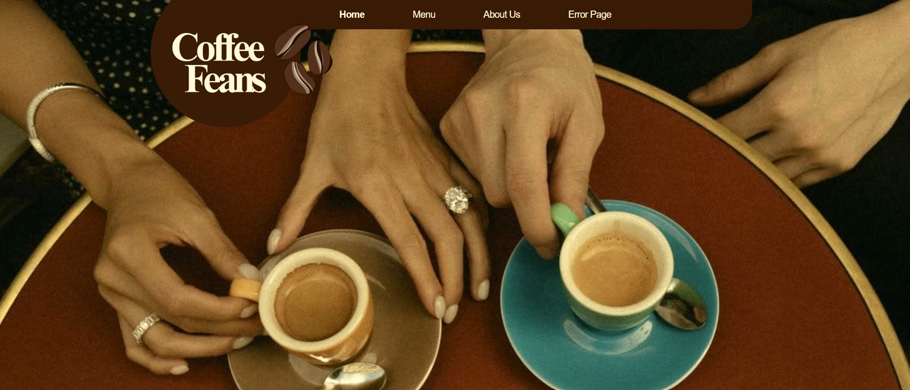

# Feans Coffee ☕

A multi-page café website built using HTML and CSS, featuring a coffee-inspired design, menu pages, and information about the café.

**[View Live Website](https://elshf7165.github.io/cafe-website/)**

## Website Preview

## About the Project

Feans Coffee is a frontend web development project designed to showcase a fictional café through a visually engaging website.

The project focuses on website layout, navigation, styling, and presenting content across multiple pages.

## Why I Built This ☕

Feans Coffee started as a school project, but it quickly became something I genuinely enjoyed working on. What began as an assignment turned into hours of experimenting with designs, learning how to code, and figuring things out through trial and error.

I found myself getting lost in the creative process, constantly changing little details and trying new ideas just to see what I could make. It was exciting to watch something I had imagined slowly come to life through code.

This project made me realize how much I enjoy combining creativity with programming. And while the original website was built around the requirements of an assignment, I don't want it to end there.

I plan to keep improving Feans Coffee, exploring new ideas, adding features, and expanding it beyond the original assignment requirements.

For me, this project is just the beginning of something I want to keep pouring my creativity and love into. 🤎

## Features

- Homepage introducing Feans Coffee
- Café menu showcasing food and drinks
- About Us page
- Custom images and visual styling
- Custom 404 error page
- Navigation between website pages

## Technologies Used

- **HTML5** — Website structure and content
- **CSS3** — Styling, layouts, and visual design
- **GitHub Pages** — Website hosting

## How to Run Locally

1. Download or clone this repository.
2. Open the project folder.
3. Open `index.html` in a web browser.

No additional installations are required.

## Project Structure

- `index.html` — Homepage
- `menu.html` — Café menu
- `about.html` — About Us page
- `404.html` — Custom error page
- `webstyle.css` — Website styling
- Image files — Website graphics and photographs

## Future Improvements 🌱

Feans Coffee is a project I want to continue growing beyond its original assignment requirements. As I learn more about web development, I hope to revisit the website and bring more of my ideas to life.

Some improvements I'd love to explore include:

- [ ] Making the website fully responsive across different screen sizes
- [ ] Adding interactive elements using JavaScript
- [ ] Improving animations and transitions
- [ ] Expanding the menu with more products and categories
- [ ] Improving accessibility and the overall user experience
- [ ] Continuing to experiment with new layouts and design ideas

I'm excited to see how this project evolves as my programming and design skills grow!

## Author

Fatima Elsheikh

Computer Science Student — University of Guelph
